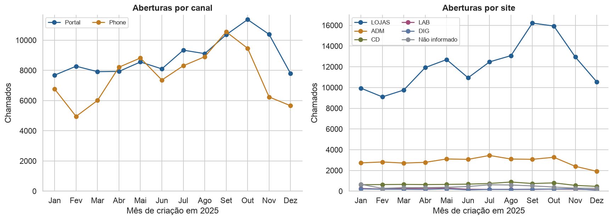

# Análise de Tickets de Suporte Drogaria Araujo

Trabalho de **Programação para Análise de Dados**, do professor Pedro Calais, com análise de demanda, satisfação e um experimento de previsão de atraso de chamados de TI.

**Grupo:** Pedro Caram, Igor Blon, Dan Maia e Gabriel Henrique.

## Acessar o trabalho

- [Notebook completo, com código, explicações e resultados executados](Analise_Tickets_Araujo.ipynb)
- [Nota mestre do projeto e preparação para a defesa](docs/Projeto_Mestre_Araujo_ML.md)
- [Figuras da análise](figuras/)
- [Resultados agregados em JSON](resultados/resumo_agregado.json)

O notebook contém **52 células**, incluindo **28 células de código executadas sem erro**, **21 figuras** e, entre elas, **cinco treemaps interativos**. No GitHub, as visualizações podem aparecer como imagens estáticas; a exploração interativa fica disponível ao abrir o notebook em um ambiente Jupyter.

## Recorte e resultados

A extração original contém 199.423 chamados fechados em 2025. A análise de demanda considera somente os **198.113 chamados criados em 2025** presentes nessa extração.

| Indicador | Resultado no recorte |
|---|---:|
| Chamados criados em 2025 | 198.113 |
| Respondentes únicos de satisfação | 7.733, ou 3,90% |
| Chamados com prazo de SLA preenchido | 96.251, ou 48,58% |
| Fechamentos em menos de 36 segundos | 76.835, ou 38,78% |
| Maior volume diário | 1.233 chamados em 01/10/2025 |
| Aumento da média mensal de Set/Out sobre Jan/Jun | 38,2% |
| Gini anual do volume entre serviços informados | 0,8909 |

Os números de 7.786 respondentes e 97.010 chamados com prazo preenchido pertencem à extração completa, antes do filtro de criação.



## Conteúdo

| Parte | Análises |
|---|---|
| 1.1 a 1.2 | Contagem de IDs únicos; evolução mensal; dia da semana e hora por canal e site. |
| 1.3 a 1.6 | Cinco treemaps; heatmap; dez dias de maior demanda; violinos de duração por satisfação e canal. |
| 2.1 | Decomposição do aumento de Set/Out por serviço, site e canal; coeficiente de Gini e curva de Lorenz. |
| 2.2 | Associação da insatisfação com SLA, duração, canal e serviço; análise agregada dos comentários. |
| Complemento de ML | Árvore de classificação com impureza de Gini e KNN; validação temporal; matrizes de confusão, precision, recall e AUC-ROC. |
| Estudo de caso | Solução de priorização de suporte da Microsoft e proposta de adaptação para a Araujo. |

## Como executar

O ambiente validado usa **Python 3.12**. Abra o notebook no VS Code com suporte a Jupyter, no JupyterLab ou em outro ambiente compatível.

```bash
git clone https://github.com/konamath/analise-tickets-araujo.git
cd analise-tickets-araujo
python3 -m venv .venv
source .venv/bin/activate
python -m pip install -r requirements.txt
```

No Windows, ative o ambiente com `.venv\Scripts\Activate.ps1` no PowerShell.

1. Obtenha as três planilhas originais pelo canal autorizado da disciplina.
2. Coloque-as em `dados/`, conforme o [guia das bases locais](dados/README.md).
3. Abra `Analise_Tickets_Araujo.ipynb` e selecione o Python do ambiente `.venv` como kernel.
4. Execute **Restart Kernel and Run All**. As planilhas não são modificadas.

Para executar sem interface gráfica, depois de disponibilizar as bases:

```bash
python -m jupyter nbconvert --execute --to notebook Analise_Tickets_Araujo.ipynb \
  --output Analise_Tickets_Araujo.executado.ipynb \
  --ExecutePreprocessor.timeout=1800
```

O notebook já tem os resultados salvos para leitura. As versões em `requirements.txt` correspondem às bibliotecas utilizadas na execução validada. A reprodução dos cálculos exige acesso às bases originais, que não são distribuídas neste repositório.

Os treemaps funcionam com Plotly. Para gerar novas imagens estáticas deles, instale opcionalmente `kaleido`; sua versão recente exige Chrome. As imagens usadas nesta entrega já estão salvas em `figuras/`.

## Tratamento e limites de interpretação

- A pesquisa é consolidada por ID antes do cruzamento, evitando multiplicar chamados.
- O SLA é cruzado exatamente por `Serviço`. Prazo ausente permanece como `Sem SLA Mapeado`.
- Os registros com menos de 36 segundos são separados nas análises de duração e mantidos no volume de demanda.
- Os preditores do ML são exclusivamente `Serviço`, `Canal`, `Hora`, `Dia_Semana` e `Site`. Transformadores são ajustados somente no treino.
- O atraso é calculado em **horas corridas**. Calendário contratual, pausas e momento separado da resolução não estão disponíveis.
- A base contém somente chamados fechados em 2025; os ainda abertos não entram na extração.
- A satisfação representa os respondentes. Associações observadas não demonstram causalidade.

### Resultado importante do experimento de ML

| Modelo | Precision | Recall | AUC-ROC | Especificidade | Acurácia balanceada |
|---|---:|---:|---:|---:|---:|
| Referência simples | 0,996 | 1,000 | 0,500 | 0,000 | 0,500 |
| Árvore | 0,996 | 1,000 | 0,917 | 0,000 | 0,500 |
| KNN | 0,996 | 1,000 | 0,856 | 0,000 | 0,500 |

No teste de novembro e dezembro, **99,6% dos chamados têm rótulo de atraso em horas corridas**. No limiar de 0,5, todos os modelos classificam todos os chamados como atrasados. Precision e recall altos, nesse caso, não demonstram uma política útil de alertas. As AUCs avaliam a ordenação das pontuações, mas não validam implantação. O alvo precisa ser confrontado com as regras efetivas de SLA.

## Dados publicados

Este repositório publica código, documentação, figuras e resultados agregados. **As planilhas brutas não são publicadas**, pois contêm nomes e textos livres de usuários e atendentes. O arquivo `.gitignore` também exclui bases locais, credenciais, ambientes Python e arquivos temporários.

O notebook evita carregar nomes, descrições dos problemas e notas de resolução. Comentários de satisfação são transformados localmente em indicadores de um vocabulário fechado; nenhum comentário original é reproduzido nas saídas.

## Fontes

As definições seguem o enunciado e o dicionário disponibilizados na disciplina. O notebook registra nome, aba e hash das planilhas e apresenta as referências conceituais junto às análises.

O estudo Microsoft analisa previsão de **insatisfação**, um alvo diferente do atraso usado no nosso experimento. AUCs desses problemas não devem ser comparadas diretamente. [Artigo original: ML and customer support, Part 1](https://medium.com/data-science-at-microsoft/ml-and-customer-support-part-1-using-machine-learning-to-enable-world-class-customer-support-c90b3b02f6a3).
